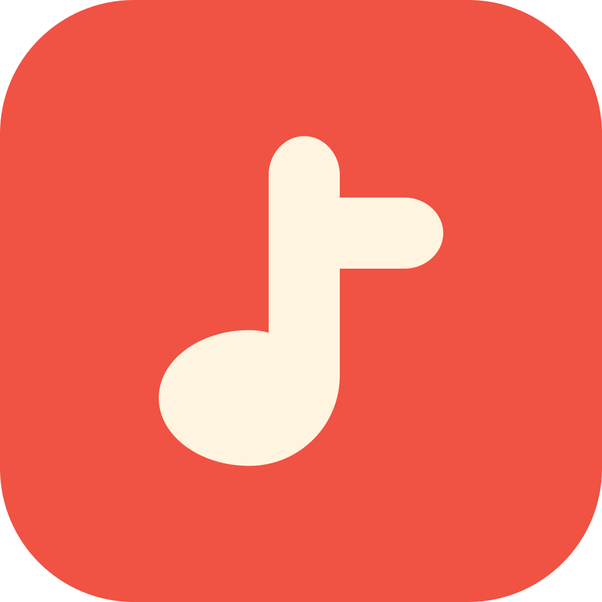

# Raag Music



A native Android music player built with Kotlin, Jetpack Compose and Media3.

**Android 8.0+ · GPL-3.0-or-later · No account required**

## Features

- Search songs, artists, albums and playlists through public YouTube Music discovery.
- Personalized Quick Picks, artist pages and region-aware discovery.
- Background audio, queues, shuffle, repeat, crossfade and a sleep timer.
- Lyrics when available, optional video playback and full-screen controls.
- Favorites, playlists, local audio import, backups and supported offline downloads.
- On-device listening history and Library Insights, with recording controls.
- Light, dark and AMOLED appearance, widgets and Android Auto browsing.

Provider availability can change. Playback, lyrics and downloads depend on the source, network and content restrictions. Cloud sync, account login, casting, push notifications and an automatic updater are not implemented.

## Build

Use **JDK 17**, Android SDK Platform **35**, Build Tools **36.0.0**, and Android Studio with AGP 9.0.1 support. The included wrapper runs Gradle 9.2.1.

1. Clone or extract the project and open it in Android Studio.
2. Select JDK 17 for Gradle.
3. Copy `local.properties.example` to `local.properties` and set your SDK path, or let Android Studio create it.
4. Build and check:

```sh
./gradlew :app:assembleDebug
./gradlew :app:testDebugUnitTest :app:lintDebug
```

On Windows, use `gradlew.bat`. The APK is `app/build/outputs/apk/debug/app-debug.apk`. Install with Android Studio or:

```sh
adb install -r app/build/outputs/apk/debug/app-debug.apk
```

The first build needs access to Google Maven, Maven Central, the Gradle distribution service and the scoped JitPack repository. No API keys, Firebase files, backend credentials or private repositories are required. Cached dependencies permit later offline builds. Optional official Firebase reporting builds are described in [Firebase setup](docs/FIREBASE.md); standard builds contain no Firebase SDK.

## Contribute

Read [CONTRIBUTING.md](CONTRIBUTING.md), [architecture](docs/ARCHITECTURE.md), [SECURITY.md](SECURITY.md) and the [code of conduct](CODE_OF_CONDUCT.md). Use the GitHub issue templates for bugs and features. Remove personal data and signed stream URLs from reports.

The Android application ID and source namespace are **`com.raagmusic.app`**. Register this exact ID when setting up Firebase. The optional benchmark module is enabled with `-PperformanceTools=true`.

## Publish on GitHub

Follow the [first-push guide](docs/OPEN_SOURCE_GUIDE.md). Use the clean source export for the first public repository so old development history is excluded:

The audit/export tools require Python 3.10 or newer and use only its standard library.

```sh
python3 scripts/public_source.py
python3 scripts/export_source.py
```

The ZIP is `dist/raag-music-source.zip`. SDK settings, build outputs, APKs, keys and `.git` are excluded. See [release/signing guidance](docs/RELEASING.md) before distributing production builds. APKs belong in GitHub Releases, not source commits.

See the [preparation and validation record](docs/VALIDATION.md) for completed checks and their scope.

## Privacy and license

Listening Insights stay on the device. Optional Firebase builds enable basic usage reporting by default, with a user-controlled off switch; standard builds contain no Firebase SDK. Music, lyric and artwork providers receive network requests. See [PRIVACY.md](PRIVACY.md).

Original source is **GPL-3.0-or-later**. See [LICENSE](LICENSE), [NOTICE](NOTICE) and [third-party notices](THIRD_PARTY_NOTICES.md). NewPipeExtractor uses GPL-3.0-or-later; the font retains its SIL Open Font License. Bundled legal/privacy documents are available offline in **Settings → About Raag Music**.

External recordings, lyrics, artwork and provider brands are not licensed by this repository. Raag Music is independent of Google/YouTube. Use media only with the necessary permission.
